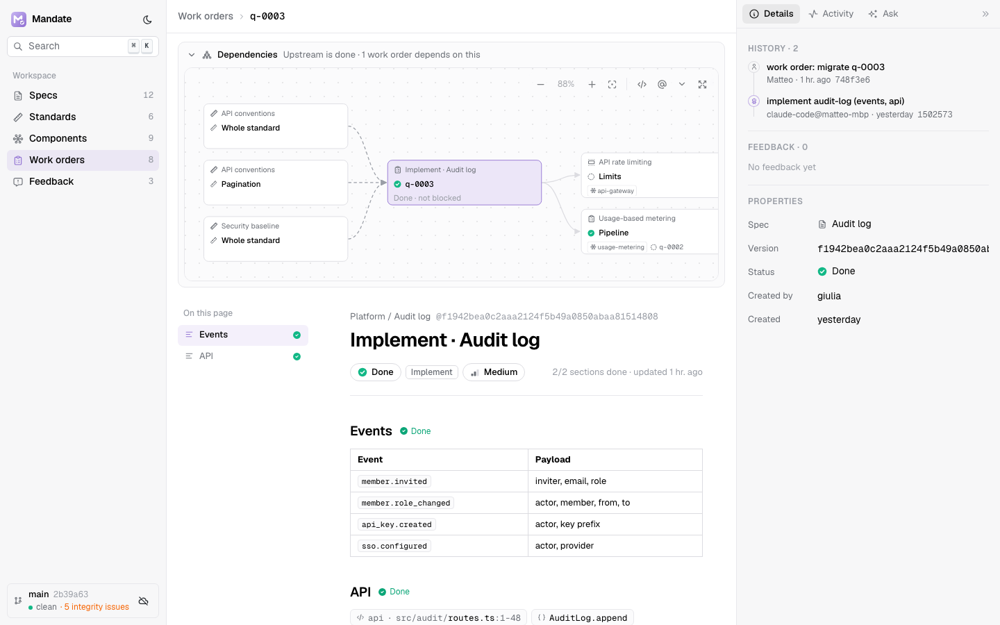
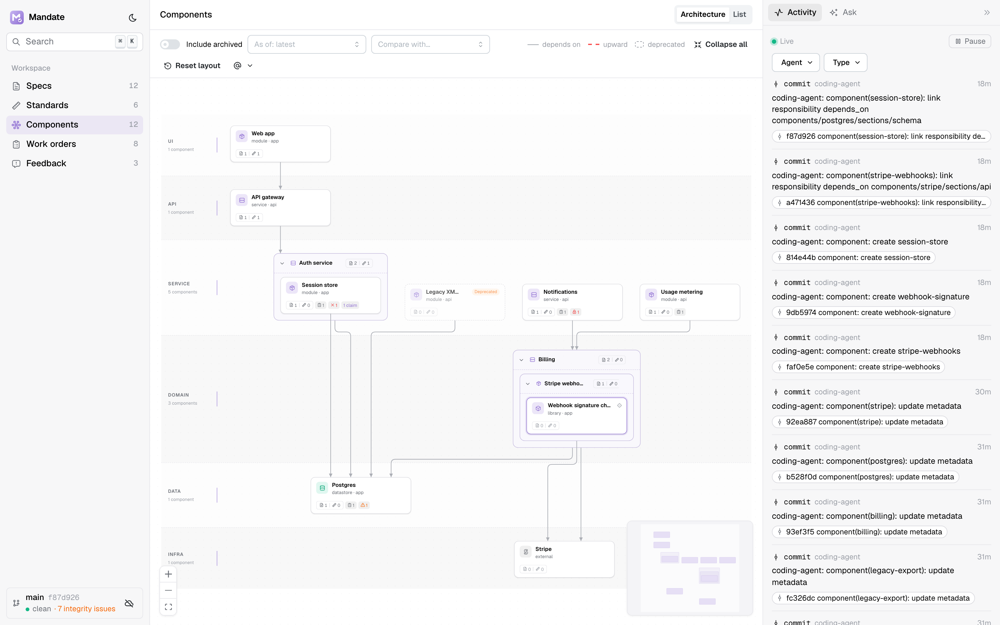
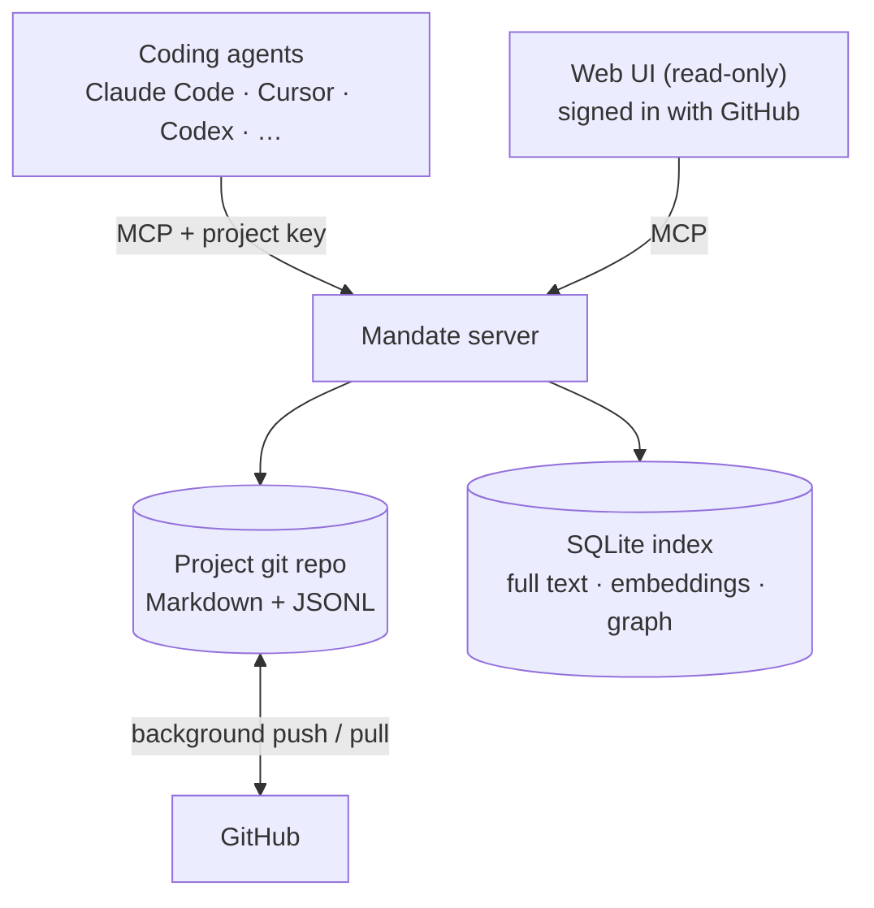

<p align="center">
  
</p>

<h1 align="center">Mandate</h1>

<p align="center">
  <b>The specification system your coding agents actually read.</b><br/>
  Specs, standards and architecture in git, served to any coding agent over MCP, with a calm, read-only UI for humans.
</p>

<p align="center">
  
</p>

---

## Why Mandate

Coding agents are fast, but they forget. They work from whatever context happens to be in the prompt, so the decisions that
matter (what to build, which rules apply, how the system fits together) get lost between sessions, agents and people.

Mandate gives that knowledge a home:

- **Specs say what to build.** They are split into typed sections, with acceptance criteria and links to the code they touch.
- **Standards say how to build it.** They hold rules with *must / should / may* levels, Do/Don't examples and scopes.
- **Components describe the system** and generate a layered architecture diagram.
- **Work orders** hand specific sections to an agent, track the claim and record what got done.
- **Feedback** captures what was unclear, and links to the spec or standard change that resolved it.

Everything is plain Markdown and JSONL in a **git repository**: every change is a commit, every version can be referenced,
and nothing is locked in. Agents read and write through **MCP** (the only interface), so it works with Claude Code, Cursor,
VS Code, Codex, Gemini CLI and any other agent that speaks MCP.

## A quick tour

### Specs and standards

Each document is a list of typed sections: markdown, Mermaid diagrams, HTML mockups, acceptance criteria and rules.
Sections link to other sections, to standards, to components and to exact lines of code (`repo/path#L10-40`, symbols).
The right-hand rail shows history, properties, dependencies and the standards in force, and **Word-style tracked
changes** come straight from git history.

Anything can be copied as a reference, for example `@mandate:mandate://specs/rate-limiting/sections/limits`. Paste it into
your coding agent and it resolves to exactly that section, at the current or a pinned version.

### Work orders



A work order points at the **sections** an agent should implement or review, pinned to a commit. Agents pick one
atomically (`work_order_next`), keep their claim alive with heartbeats, mark sections done and record verifications.
The dependency graph shows what is upstream and what is waiting on it.

### Architecture



Components declare the code they own (globs), their layer, their dependencies and the components they contain. Mandate
draws the layered, top-to-bottom diagram, flags dependencies that point *up* a layer, and lets you pan, zoom, collapse
groups and focus on a component's neighbourhood.

### Search everything


<kbd>⌘K</kbd> searches full text, meaning (embeddings), symbols, code paths and IDs together, with facets by kind and status.
Agents get the same search over MCP, plus a temporal **knowledge graph** they can traverse or query with a
**Cypher** subset: "what breaks if this standard changes?", "which specs touch `src/auth/session.ts`?", "what did this
look like last Tuesday?".

### Live activity and Ask


The **Activity** tab streams what agents are doing as it happens (section edits as inline diffs, status changes, claims,
verifications, commits), and pages refresh on their own. The **Ask** tab answers questions about the project with the
model of your choice. It uses the same read-only MCP tools, shows each tool step (including the Cypher it ran), and
answers with clickable references, tables and graphs.

## How it works



- **Projects.** Each project is its own GitHub repository (or a folder in one), with its own index, activity feed, Ask
  history and MCP endpoint (`/p/<project>/mcp`). New projects are created in the UI by picking a GitHub repo, personal
  or from an organisation.
- **Git is the database.** Writes are commits with `Agent:` / `Work-Order:` trailers. Mandate pushes in the background
  and never force-pushes.
- **Strict by design.** Every MCP call is validated: status transitions, a done gate on acceptance criteria, claim
  conflicts, link direction rules, append-only verifications and immutable closed feedback. Errors carry codes an agent
  can act on.
- **Indexes stay current.** Full-text, symbol and graph indexes update on every commit. Embeddings are computed in the
  background through a durable SQLite job queue.

## Quick start

Requirements: Node.js 22+, git, and optionally [Ollama](https://ollama.com) for semantic search.

```sh
git clone https://github.com/snork-alt/mandate.git
cd mandate
npm install
npm run dev          # API on :4000, web UI on :5173
```

1. Open **http://localhost:5173**. On first run Mandate shows **Set up GitHub sign-in** and walks you through creating a
   GitHub OAuth App. The client ID goes in `~/.mandate/config.json` and the secret in `~/.mandate/secrets.env`.
2. Sign in with GitHub and click **New project** to pick the repository that will store your specs.
3. Click **Connect agent** in the sidebar and copy the config for your coding agent, for example:

   ```sh
   claude mcp add --transport http mandate-myproject http://localhost:4000/p/myproject/mcp \
     --header "Authorization: Bearer <key from the Connect agent dialog>"
   ```

4. Ask your agent to *"use Mandate to find the specs and standards for `src/auth/` before changing it"*, or let it pick up
   a work order with `work_order_next`.

Want sample data? `npm run seed` fills a local project with specs, standards, components and work orders, with
backdated history.

## Configuration

Everything lives in `~/.mandate/`. Secrets are only ever referenced by environment-variable name.

| File | What it holds |
|---|---|
| `config.json` | Your settings: GitHub sign-in, Ask models, embeddings, git backend, auto-push defaults |
| `secrets.env` | API keys and the GitHub client secret (`KEY=value`, mode 0600, never logged) |
| `projects.json` | The project registry, managed by Mandate |
| `keys.json` | Per-project agent keys (mode 0600) |

**Ask models.** Configure as many as you like and pick one per question in the Ask box. Anthropic, OpenAI, Google and any
OpenAI-compatible endpoint (including a local Ollama) are supported:

```json
"ask": {
  "default": "opus",
  "models": [
    { "id": "opus", "label": "Opus 5.5", "provider": "anthropic", "model": "claude-opus-5-5", "apiKeyEnv": "ANTHROPIC_API_KEY" },
    { "id": "local", "label": "Llama (local)", "provider": "openai-compatible", "model": "llama3.1", "baseUrl": "http://localhost:11434/v1" }
  ]
}
```

## Development

```sh
npm run typecheck
npm test             # vitest across packages
npm run build
```

| Package | |
|---|---|
| `packages/doc` | The document format: sectioned Markdown with frontmatter, pluggable section types, byte-stable round trips |
| `packages/shared` | Types, zod schemas and `mandate://` references shared by server and UI |
| `packages/server` | Fastify + MCP server, git storage (embedded libgit2 or the git CLI), SQLite index, Cypher compiler, Ask agent |
| `packages/web` | React + Mantine UI, itself an MCP client |
