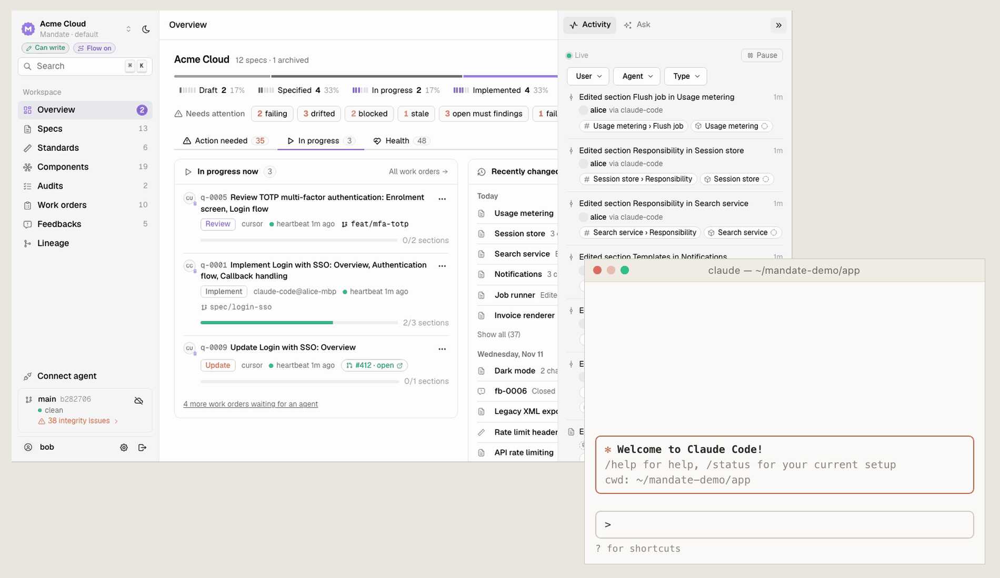
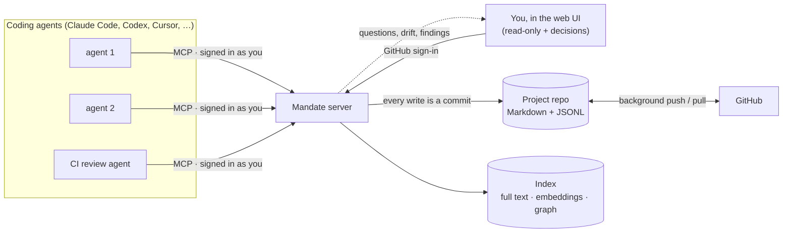
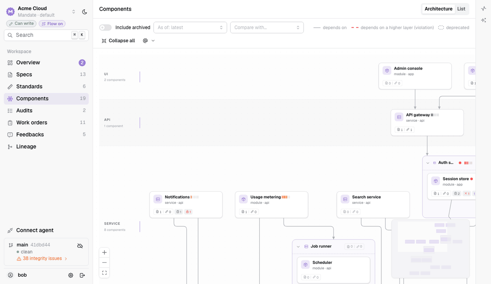
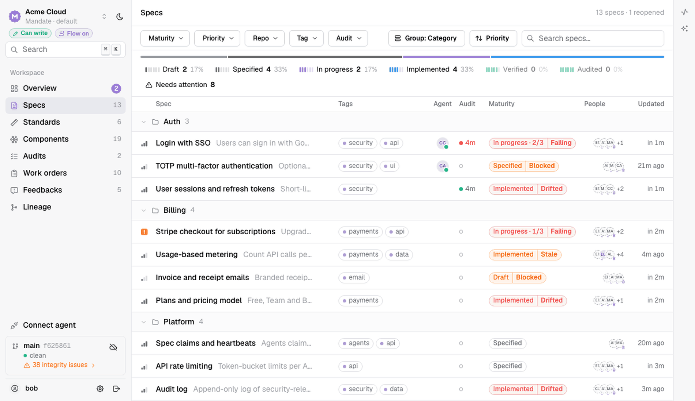
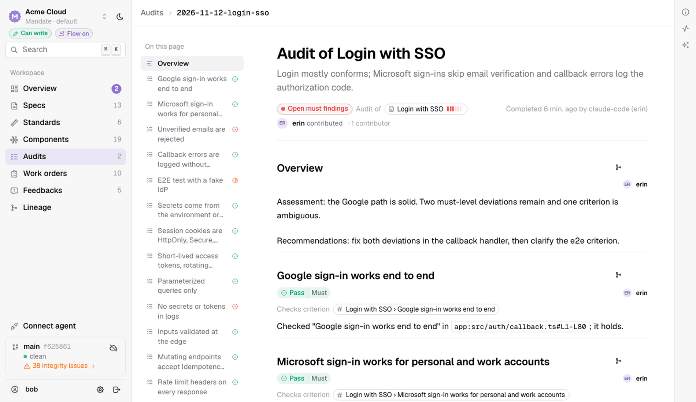

<p align="center">
  
</p>

<h1 align="center">Mandate</h1>

<p align="center">
  <b>Specs your coding agents read, write and keep in sync with the code.</b><br/>
  A git-backed, MCP-native spec system for teams that run many coding agents at once, with a read-only web UI for humans.
</p>

<p align="center">
  
  
  
  
  
  
</p>

<p align="center">
  
  <br/><sub>A coding agent picks up a task; Mandate tracks the work order, code and spec as it happens. (A real Claude Code run against a demo project, sped up; the terminal replays the run's actual tool calls, lightly trimmed.)</sub>
</p>

---

## The problem

**Many agents, no shared picture.** When five coding agents work in parallel (yours, your teammates', CI), nobody can
say what is being built right now, by whom, against which version of the requirements, or what is waiting on a human.

**Specs drift.** You iterate fast: *"actually, make it 7 days"*, *"also handle Microsoft accounts"*. Each instruction lands
in one agent's chat, the code changes, and the spec doesn't. A week later the spec, the tests and the code describe three
different products, and the next agent works from the wrong one.

## How Mandate solves it

Mandate gives specs a single home that agents treat as the source of truth, and makes them keep it current as part of the
work.

- **One place for intent.** Specs, standards and components are Markdown in a git repository. Coding agents read and write
  them over MCP (the only interface), so every agent works from the same, current version.
- **Change goes through the spec.** The Mandate skill turns *"add remember-me to login"* into a spec change, a work order
  and a verified delivery, so code and spec move together.
- **Drift is detected, not discovered.** Acceptance criteria carry verifications. When a criterion changes after it
  passed, or a done spec no longer meets its done gate, Mandate flags it.
- **Humans see everything and decide what matters.** A calm, read-only UI shows maturity, live agent activity, lineage and
  the decisions waiting for you.



## A tour

### Architecture at a glance



Components declare the code they own (globs), their layer, their dependencies and the components they contain. Mandate
draws a layered, top-to-bottom diagram (UI → API → services → domain → data → infra) with nested components, flags
dependencies that point *up* a layer, and lets you pan, zoom, collapse groups, focus on a component's upstream and
downstream links, and compare against an earlier commit. Each component page lists its interfaces, the specs that affect
it, the standards it follows and the code it owns.

### Overview: what needs you


The Overview answers "how far along are we, and what is waiting on me?". The maturity bar shows every spec on the ladder
*Draft → Specified → In progress → Implemented → Verified → Audited*, with overlays for **failing**, **drifted**,
**blocked** and **stale**. **Action needed** collects every human decision in one list: open questions from agents,
legacy waivers, draft standards, stale claims, drifted done specs, contradicted audits and integrity issues. **In progress**
shows claimed work orders with their branches and heartbeats; **Health** shows verification and audit coverage.

Agents ask you questions **asynchronously** (`question_ask`): they keep working on what doesn't depend on the answer, and
you answer in the UI when you get to it. An answered question becomes the recorded proof for the write it decides, for
example a change to a standard.

### Specs, maturity and drift



A spec is a list of typed sections: Markdown, Mermaid diagrams, HTML mockups, acceptance criteria and rules. Sections link
to other sections, to standards, to components and to exact code (`repo:path#L10-40`, symbols). The rail shows history
with Word-style tracked changes from git, properties, dependencies and the standards in force.

- **Maturity badges** are derived, not hand-set: from implemented sections, verified criteria and audits.
- **Drift:** a done spec that no longer satisfies its done gate (criteria added, changed or unverified since) is marked
  *Drifted*, with the exact criteria and why. Sections whose dependencies changed show *Upstream changed*.
- **Standards** hold rules with *must / should / may* levels, Do/Don't examples and scopes. They are never changed without
  your explicit confirmation.
- Anything can be copied as a reference, e.g. `@mandate:mandate://specs/rate-limiting/sections/limits`. Paste it into
  your coding agent and it resolves to exactly that section, at the current or a pinned version.

### Work orders


A work order hands specific **sections** to an agent, pinned to a commit. Agents pick one atomically
(`work_order_next`), **claim** it on a **branch** (and worktree) and keep the claim alive with heartbeats. As they go they
mark sections done, record the **code they touched**, notes and deviations, and a verification for each acceptance
criterion. Reviewers (people or agents) leave blocking or non-blocking comments. Completion goes through the done gate,
and the agent reconciles the spec and components with what was actually built.

### Audits and lineage



An **audit** checks a spec (or a standard) against the code, item by item, with evidence. Findings that are code deviations
become **fix work orders** (`audit_findings_to_work_orders`); findings that show the spec itself is ambiguous become
requests on the spec.

**Lineage** answers "why does this exist?" and "what did it lead to?" for any element: specs, sections, standards,
components, work orders, requests, audits and findings, verifications, commits, PRs and code. Every MCP write accepts a
`cause`, recorded in commit trailers and a `caused_by` graph edge, so the chain is captured at write time, not
reconstructed later. The Lineage page draws it as a graph (causes above, effects below) or as a timeline, with time travel
to any commit or date. Before a change, `blast_radius` lists what it would hit: dependent specs, followers of a standard,
owned code and open work orders on the same files.

### Ask


The **Ask** panel is answered by **your own coding agent**: Mandate has no model, no provider and no API key for it.
You type a question (optionally with context chips); it is stored as an ask thread and delivered as an event to the
agent you pick (the only one online is chosen for you; *Any agent* queues it for whoever is free). The agent hands it to
a read-only Claude Code subagent, `mandate-ask` (installed by `mandate connect` in `~/.claude/agents/`: Read, Grep, Glob,
Mandate's read tools and `ask_answer`; model sonnet), in the background and keeps working; the subagent answers with
`ask_answer`, in parts if it likes, and the panel shows the answer as it grows and who is answering. No agent online:
the panel says *open Claude Code with `mandate claude`*, the question waits and is answered when an agent connects.
`ask_pending` is the catch-up for a session that missed the event.

### Who did what

Every write records the coding agent **and** the GitHub user it acted for (`Mandate-User:` and `Agent:` commit trailers).
Pages show "Created by Alice via claude-code", contributor avatars per document and section, and the activity feed can be
filtered by user and agent. Commits made for a signed-in person are authored by that person.

### Search everything

<kbd>⌘K</kbd> searches full text, meaning (embeddings), symbols, code paths and IDs together. Agents get the same search over
MCP, plus a temporal **knowledge graph** they can traverse or query with Cypher: *"what breaks if this standard changes?"*,
*"which specs touch `src/auth/session.ts`?"*, *"what did this look like last Tuesday?"*.

## Quick start

Requirements: Node.js 22+ (and git, to push your projects). No compiler needed: native modules ship prebuilt.

### 1. Install the server

```sh
npx getmandate install
npx getmandate install --public-url https://mandate.example.com   # behind your HTTPS reverse proxy
```

The installer installs the `mandate` command, starts Mandate in the background (launchd on macOS, systemd `--user` on
Linux), adds the Mandate skills and slash commands to the coding agents it finds, and opens the setup wizard. For a public
address it listens behind your reverse proxy, prints ready-to-use Caddy and nginx configs tuned for MCP's streaming
responses, and prints the one-time setup link with an SSH tunnel to reach it safely.

Many browser tabs: over plain HTTP/1.1 a browser opens at most 6 connections per origin, so the web UI shares a single
live-update stream across all tabs of the same browser (one tab holds it and relays to the others). Behind the
generated Caddy or nginx config (HTTPS with HTTP/2) this limit disappears altogether.

Useful flags: `--port N`, `--bind ADDR`, `--no-service`, `--no-open`, `--no-agents`, `--agents a,b`, `--dry-run`, `--yes`.

### 2. Run the setup wizard


1. **GitHub App.** Mandate creates one in one click, on your account or an organization: you review it on GitHub and press
   *Create GitHub App*, and GitHub hands the credentials back. The client secret, webhook secret and private key go to
   `~/.mandate/secrets.env` and a 0600 key file, never `config.json`. An existing OAuth App also works.
2. **Git.** System git or the built-in one, and whether to push to GitHub automatically.
3. **Semantic search** *(optional)*. Local embeddings need no key; or an OpenAI-compatible URL, or keyword search only. (No
   language model is configured anywhere: Ask is answered by your coding agents.)
4. **Database** *(optional)*. SQLite (built in) or Postgres.
5. **Sign in** with GitHub. You become the admin.

Everything can be changed later in Settings.

### 3. Create a project

A project is a GitHub repository (or a folder in one) that holds its specs. **New project** in the UI lists the
repositories the GitHub App is installed on, personal or from an organization, with a link to install it on more. Each
project has its own index, activity feed, Ask threads and MCP endpoint (`<server>/p/<project>/mcp`).

### 4. Connect your coding agents

On each developer machine, one line installs the Mandate CLI (`getmandate`) and wires every coding agent it finds to a
project: the MCP server entry, the Mandate skills and the slash commands. The **Connect agent** dialog shows it with a
copy button:

```sh
curl -fsSL https://mandate.example.com/p/<project>/install.sh | sh
# flags go to `getmandate connect`:  … | sh -s -- --agents claude-code,codex --dry-run
# remove the wiring again:           … | sh -s -- --uninstall
# remove the wiring AND the CLI:     curl -fsSL https://mandate.example.com/uninstall.sh | sh   (--dry-run, --purge)
```

On Windows PowerShell: `irm https://mandate.example.com/p/<project>/install.ps1 | iex` (uninstall:
`irm https://mandate.example.com/uninstall.ps1 | iex`). On the machine running Mandate, `mandate connect` in a code
repository does the same.

- The CLI comes from the Mandate server itself, at the server's exact version (`<server>/getmandate.tgz`, checked
  against its SHA-256, which is embedded in the script; npm is never asked for `getmandate`). It is installed with
  `npm install -g`; without write access to npm's global folder it goes to `~/.mandate/cli` and the script prints the
  `PATH` line to add (it never edits your shell files). Running the line again installs the server's CLI build
  whenever it differs from the installed one (the tarball's SHA-256, recorded in `~/.mandate/cli-build`, not just the
  version; `--reinstall` forces it), then runs `getmandate connect`.
- The skills and slash commands it writes are short stubs: the coding agent loads the current instructions from the
  server (`instructions_get`), so a server update reaches every agent without reinstalling.
- The script holds no token and pins the server's exact Mandate version.
- Agents sign in with GitHub on first use (MCP OAuth, with PKCE and short-lived, project-bound tokens), so nothing secret
  is written. Agents that can't sign in by themselves use a personal token (`--auth token`), kept only in
  `~/.mandate/env.sh` (0600).
- Inside a git repo it asks before adding the repo's MCP entry and the `CLAUDE.md` / `AGENTS.md` section (`--yes` to
  accept), and ends with a per-agent summary.
- To read the script before running it, compare the published checksum:
  `curl -fsSLO …/install.sh && curl -fsSL …/install.sh.sha256 | shasum -a 256 -c - && sh install.sh`.

**Supported agents.** Paths and formats come from each agent's official docs; capabilities that couldn't be verified are
written only with `--force`.

| Agent | MCP | Skills | Slash commands | Instructions file |
|---|---|---|---|---|
| Claude Code | ✓ | ✓ `~/.claude/skills` | ✓ `.claude/commands` | `CLAUDE.md` |
| Codex | ✓ | ✓ `~/.agents/skills` | ✓ `~/.codex/prompts` | `AGENTS.md` |
| Cursor | ✓ | ✓ `~/.agents/skills` | ✓ `.cursor/commands` | `AGENTS.md` |
| VS Code (Copilot) | ✓ | ✓ `~/.agents/skills`, `~/.copilot/skills` | ✓ `.github/prompts` | `AGENTS.md` |
| Gemini CLI | ✓ | ✓ `~/.agents/skills` | ✓ `.gemini/commands` (TOML) | `GEMINI.md` |
| Windsurf / Devin Desktop | ✓ | ✓ `~/.agents/skills` | MCP prompts | `AGENTS.md` |
| opencode | ✓ | ✓ `~/.agents/skills` | ✓ `.opencode/commands` | `AGENTS.md` |
| JetBrains Junie | ✓ user scope | ✓ `~/.agents/skills` | unverified | `AGENTS.md` |
| Amp | ✓ | ✓ `~/.agents/skills` | skills | `AGENTS.md` |
| Goose | manual (YAML snippet printed) | ✓ `~/.agents/skills` | – | `AGENTS.md` |
| Cline | ✓ user scope | ✓ `~/.cline/skills` | MCP prompts | `AGENTS.md` |
| Zed | unverified | ✓ `~/.agents/skills` | – | `AGENTS.md` |

`mandate agents` shows what was detected on your machine and what is installed.

**Who sees what.** Access follows GitHub, per project: if you can read a project's repo, you see the project and your
agents can use the read tools; if you can push, they can also write (org and team grants count, checked with your own
GitHub token and cached for 5 minutes). Without access the project doesn't exist for you (404). `allowedUsers` /
`allowedOrgs` optionally restrict who may sign in; people in `allowedUsers` are the admins. CI uses named service
accounts (`mandate key create <project> --service <name>`).

### 5. Work as usual

Ask your agent for what you want, e.g. *"add remember-me to login"*. One **master skill** (installed for every agent; the
MCP server's instructions carry the same rules for agents without it) runs the flow:

- **Request.** Every instruction you give is recorded as a **request** (it needs no approval from you). `spec_match` finds
  where it fits (already covered, extend a section, a new section or spec, or a cross-cutting rule for a standard). The
  agent updates the spec (an acceptance criterion for every changed section) and the standards, then opens a **work order
  that carries the full plan**: steps, files to change, the tests it will write (each mapped to the acceptance criteria it
  proves) and risks. Only questions the agent raises itself (`question_ask`: standards, waivers, doubts) wait for your
  answer, and it keeps working on whatever does not depend on it.
- **Delivery.** The agent claims the work order, marks sections done as they land (the code it touched is copied onto the
  spec section, which then reads "Implemented by" that work order), and records a passing verification per criterion that
  names its test (the spec then reads "Proved by" that test). `work_order_complete` refuses until every acceptance
  criterion the work order covers has a test-linked pass; completing it closes the request. If the spec is unclear, the
  agent asks you instead of guessing.
- **`/mandate <what you want>`** drives the whole flow by itself. It records the request, then loops on **`flow_next`**, a
  state machine in the server that returns the next step (tool, arguments, why) from the stored state: spec match, spec and
  standard changes with acceptance criteria, the work order with its full plan, claim, plan steps, sections, a test-linked
  verification per criterion, completion, request closed. The server enforces the order (`flow_out_of_order`, claims). The
  agent asks you **only when necessary** (ambiguity that changes behaviour, a conflict with a spec or standard, an
  irreversible step, a standard confirmation); anything else it decides and records on the request as a **decision**.
  Several requests can be in flight: `/mandate status` lists them, `/mandate resume <request>` continues one. A question
  belongs to a request and says what it **blocks** (the request, a work order, a step, a section); the agent skips what is
  blocked and carries on elsewhere. Questions wait in **Waiting for you** (sidebar badge), grouped by request, answered inline.
  The installer pre-approves the project's Mandate tools in Claude Code (`mcp__mandate-<project>__*`) so the loop is not
  interrupted by prompts.
- **Strict flow** (opt-in, Settings → Agent flow, admins): the project installer then adds a Claude Code `PreToolUse` hook
  (`mandate guard`, in the repo's `.claude/settings.local.json`) that refuses Edit, Write, MultiEdit and NotebookEdit unless
  the agent holds a claimed work order with a step in progress (`flow_edit_allowed`). It needs a personal token and fails
  open when Mandate cannot be reached.
- **`/mandate-flow on|off|status`** (and `questions mandate|chat`) turns the flow on or off for your agent client, within
  the project policy an admin sets in Settings → Agent flow (*required*, *optional* or *off*). Only the agent changes it
  (Settings shows it read-only). With the flow off, the server refuses that agent's write tools (`flow_off`) and Mandate
  is read-only context; the agent saves the returned instructions to its memory.
- **`/mandate-bootstrap`** reverse-engineers an existing codebase into Mandate in three stages, each by a fresh agent:
  **extract** typed notes (kept in `~/.mandate/bootstrap/`, never in the repo), **distill** them into components, standards
  and specs (with your confirmation for every standard), and **review** the result against the code. Everything it writes
  is marked *Inferred* until you confirm it; `--resume` continues a run.

### Event delivery to Claude Code

Mandate has news for your agent while it is idle: *your question was answered*, *your claim was released*, a work order or
spec section it works on changed, a review outcome arrived. Claude Code does not show MCP notifications to the model, so
Mandate pushes through the two mechanisms Claude Code documents for this, over a small authenticated stream of its own:

- **Stream.** `GET /p/<project>/events` (Server-Sent Events) carries the same per-client news the agent sees as `news` on
  tool replies. Auth is the same Bearer the MCP endpoint takes (personal token or service key; never the web UI cookie),
  the events are those of *your own* client identity (`<login>/claude-code`), each has `id:` = the news item's sequence number, and
  `Last-Event-ID` resumes. `GET /events/pending?since=N` is the JSON catch-up; `POST /events/ack {ids}` marks items read.
  An item is **claimed** by the first receiver that gets it (`pushed_to` on the news item), so the channel, the hook and a
  catch-up never deliver it twice; it stays *unread* (and keeps showing as `news` on tool replies) until the agent reads
  the referenced item or acks it, and a pushed item still unread after 10 minutes is pushed again.
- **Channel (preferred).** `mandate channel` is a stdio MCP server that declares `claude/channel` and turns each event
  into a `<channel source="mandate_events_<project>" kind=… ref=…>` message, which wakes an idle session. It is one-way:
  the only sender is your Mandate server (with your own token); no tools, no inbound commands. Start Claude Code through
  the launcher: `mandate claude [claude args]` = `claude --dangerously-load-development-channels server:mandate_events_<project> …`
  (channels are a research preview and custom channels need that flag; org admins can instead list the plugin in
  `allowedChannelPlugins`, and Team / Enterprise orgs must enable channels).
- **Hooks (fallback, and catch-up).** `mandate connect` also writes Claude Code hooks (`~/.claude/settings.json`):
  `mandate events --pending --format=claude` at SessionStart (events missed while Claude Code was not running, as
  additional context) and `mandate watch --rewake` as an `asyncRewake` hook on SessionStart / UserPromptSubmit / Stop: it
  blocks on the stream and exits 2 with the event text, which wakes Claude; it is re-armed at the next turn start / end
  (a session that was idle with no hook event since the 55-minute timeout is only woken again by the next prompt). The
  watcher exits at once when this session's channel is active (a marker file the channel keeps, found through the hook's
  parent processes), so nothing is delivered twice.

`mandate connect … --push channels|rewake|off` (default `channels`: channel entry + hooks; `rewake`: hooks only; `off`:
neither, and removes an earlier setup); `--remove` and `uninstall` take the channel entry and the hooks out again.

**Credentials.** Claude Code keeps its MCP sign-in (OAuth) token to itself, so the channel and the hooks use a **personal
token** (web UI → Connect agent → Personal tokens): `mandate channel login --project <id>` stores it in
`~/.mandate/channel/<id>.token` (0600), or it is read from `MANDATE_CHANNEL_TOKEN`, `MANDATE_KEY_<PROJECT>` or
`~/.mandate/env.sh`. It is sent only to the server URL in the channel entry, as a Bearer header; it is never written to
`~/.claude.json` or a repo. The channel stays idle (and consumes nothing) when Claude Code was not started with channels
enabled, so plain `claude` sessions are served by the hooks.

### Comments on anything, answered by your agents

Every object takes comments: a section of a spec, standard or component (optionally a `#Lx-Ly` range), a request, a work
order or one of its steps. The web UI shows a **badge on each section** (filled: open threads, outlined: only resolved,
dashed: none) that opens the **Comments** tab of the side panel (a bottom sheet on a phone): the page's threads with the
active one expanded, replies as they arrive, a reply box that says who it goes to, *Make it a request*, *Resolve*, and a
*New thread* box. Selecting text in a section offers a small *Comment* button.

- **Routing.** `to` (the UI picker) or `@mention` addresses an agent or user; otherwise the **responsible agent** is woken:
  the holder of the claim on the related work order, else the agent running the related request. A reply goes to the agents
  already in the thread (a conversation needs no mentions), and a reply on a resolved thread reopens it. Nobody
  responsible: nothing is woken and the UI asks which agent should take it (online agents with their state, a suggestion:
  an idle agent on the same code repo, else the least busy; *Any agent* queues it for the next `flow_next`). Delivery is an
  event (`comment_added`) over the same stream / channel as the other news, carrying the thread so far.
- **What the agent does.** Question or remark: it answers in the thread. A change: it runs the `/mandate` flow
  (`request_create { source: "comment" }`, or attaches to the request in flight on that object), replies with the request
  link, and when the work order completes posts one final reply (what changed, the commit) and resolves the thread.
  *Make it a request* forces the flow. `flow_next` lists the comments that wait for the agent.
- **Blocking.** A blocking comment on a work order, section or step stops `work_order_complete`; on a request it stops
  `flow_next` for that request until resolved.
- **Presence.** `agents_presence` (also what the picker uses): online = an event stream is connected (or a tool call in the
  last minutes), busy = holds a claim (with what), else offline. It is kept in memory: it rebuilds as agents reconnect.

## Commands

| | |
|---|---|
| `mandate open` | Open Mandate: the setup wizard while setup is pending, else the UI |
| `mandate connect [--project id] [--url server] [--agents a,b] [--push channels\|rewake\|off] [--remove]` | Link the current repo to a project for your coding agents |
| `mandate claude [args]` · `channel login --project id` | Claude Code with the Mandate event channel; store the personal token the event stream uses ([Event delivery](#event-delivery-to-claude-code)) |
| `mandate status` · `doctor` | State, URL, version, projects and setup; diagnostics with fixes |
| `mandate start` · `stop` · `restart` · `logs -f` | Control the background service (`start --foreground` runs it in the terminal) |
| `mandate update` | Install the latest version and restart |
| `mandate uninstall [--purge]` | Remove the service and all agent wiring; keeps `~/.mandate` unless `--purge` |
| `mandate key create <project> --service <name>` · `key list` · `key revoke <id>` | Service-account keys for CI |
| `mandate agents` | Coding agents found on this machine: what each supports, and what is installed |
| `mandate bootstrap init · status · validate · clean` | Run folders for `/mandate-bootstrap` |

`install`, `connect` and `uninstall` are idempotent, take `--dry-run` and `--yes`, act on the detected agents by default
(`--agents a,b` to choose, `--all` for every agent), and mark every file they write as managed by Mandate.

## Configuration

Everything lives in `~/.mandate/`. Secrets are only ever referenced by environment-variable name.

| File | What it holds |
|---|---|
| `config.json` | Address (`server.publicUrl` / `bind`), GitHub sign-in, embeddings, git backend, auto-push. Edited by the wizard / Settings or by hand |
| `secrets.env` | API keys and the GitHub client secret (`KEY=value`, mode 0600, never logged) |
| `projects.json` | The project registry, managed by Mandate |
| `keys.json` | Service-account keys for CI (mode 0600) |
| `state.sqlite` | Server state: sessions, encrypted GitHub tokens, personal / OAuth tokens (or Postgres, below) |
| `env.sh` | Personal tokens for `connect --auth token` (mode 0600) |
| `logs/server.log` | The background service's log (`mandate logs -f`) |

Saved settings apply without a restart, including the git backend and the database; changing the address restarts the
service.

**Old `ask` block.** Earlier versions had a server-side Ask model (`"ask": { ... }`). It is gone: a config that still has the block starts normally with a warning, the block is ignored; delete it.

**Postgres.** Server state lives in SQLite by default. To share it between several server instances, put the URL in
`~/.mandate/secrets.env` and select it (Settings → Database, or by hand):

```json
"database": { "driver": "postgres", "urlEnv": "MANDATE_DATABASE_URL", "ssl": "require", "pool": { "max": 10 } }
```

Mandate creates a `mandate_server` schema and one `mandate_<project>` schema per project, where the search index (full
text, trigram, pgvector HNSW and the temporal graph) is published after every sync. It needs PostgreSQL 14+ with `vector`
and `pg_trgm`; **Test connection** in Settings checks all of it. `npm run mandate -- db copy` moves sessions and tokens from
SQLite. Your specs stay in git. On Supabase, use the direct connection or the session pooler (port 5432) with
`?sslmode=require`.

**Git push credentials.** With a GitHub App configured, Mandate pushes over HTTPS with short-lived installation tokens kept
in memory only, so no SSH key is needed. `git.auth.method: "ssh"` uses `sshKeyPath` or the ssh-agent instead, and the
`cli` backend can keep using your own git credentials.

## Architecture

- **Git is the database.** Every write is a commit with `Agent:`, `Mandate-User:`, `Request:` and `Work-Order:` trailers. Mandate pushes
  in the background and never force-pushes.
- **MCP is the only interface**, for agents and for the web UI, which is itself an MCP client. The UI session is
  read-only except for human decisions (answering questions, rejecting requests, releasing stale claims), which
  go through the same write tools with the same gates and are attributed to you.
- **The request flow by default.** Agents see the ~47 `core` tools: project info, `search` / `get` / `list`, the request
  tools (`request_create` ...), `spec_match`, the document edits (`create`, `section_insert`, links), the work-order
  steps, verification, questions, `status_set`. `tools_enable { sets }` adds `bootstrap`, `review`, `lineage` or `admin`
  (the server sends `tools/list_changed`); clients that don't refresh their list can use `…/p/<project>/mcp?tools=core,review`
  or `?tools=all`. Any tool can be called by name even when it is not listed,
  and the older names (`spec_get`, `spec_status_set`, `feedback_create` ...) still work. Requests were called feedback
  before: `mandate://feedback/<id>` refs, `of: "feedback"`, `Feedback:` commit trailers and `feedback.jsonl` are still read.
- **Strict by design.** Every call is validated: status transitions, the done gate on acceptance criteria, claim
  conflicts, link direction rules, append-only verifications. Errors carry codes an agent can act on.
- **Indexes stay current.** Full-text, symbol and graph indexes update on every commit; embeddings are computed in the
  background through a durable job queue.

| Package | |
|---|---|
| `packages/doc` | The document format: sectioned Markdown with frontmatter, pluggable section types, byte-stable round trips |
| `packages/shared` | Types, zod schemas and `mandate://` references shared by server and UI |
| `packages/server` | Fastify + MCP server, git storage (embedded libgit2 or the git CLI), SQLite / Postgres index, Cypher compiler |
| `packages/web` | React + Mantine UI, itself an MCP client |
| `packages/cli` | The `getmandate` npm package: the `mandate` command (also installed as `getmandate`), service, agent wiring; bundles the server and the built UI |

## Development

```sh
git clone https://github.com/snork-alt/mandate.git
cd mandate
npm install
npm run dev          # API on :4000, web UI with hot reload on :5173
npm run seed         # optional: a sample project with specs, standards, components and work orders
```

In dev, the installer download (`/getmandate.tgz`) is built on demand from the sources and rebuilt when they change
(`MANDATE_CLI_AUTOBUILD=0` turns this off).

```sh
npm run typecheck
npm test             # vitest across all workspaces
npm run build        # server + web dist + the publishable CLI (packages/cli/dist)
npm start            # production mode: one port, the server serves the built UI
npm run smoke        # npm pack → npx <tarball> install in a temp HOME → start → /health → UI
```

## License

Mandate is licensed under the [Functional Source License, Version 1.1, ALv2 Future License](LICENSE.md) (FSL-1.1-ALv2).

- **You can:** use, self-host and modify Mandate for your own team or company, use it for education and research, and contribute back.
- **You can't:** offer Mandate, or something substantially similar built from it, as a competing commercial product or hosted service.
- **It becomes Apache-2.0:** each release converts to the Apache License 2.0 two years after it is published.

Copyright 2026 Matteo Pelati.
