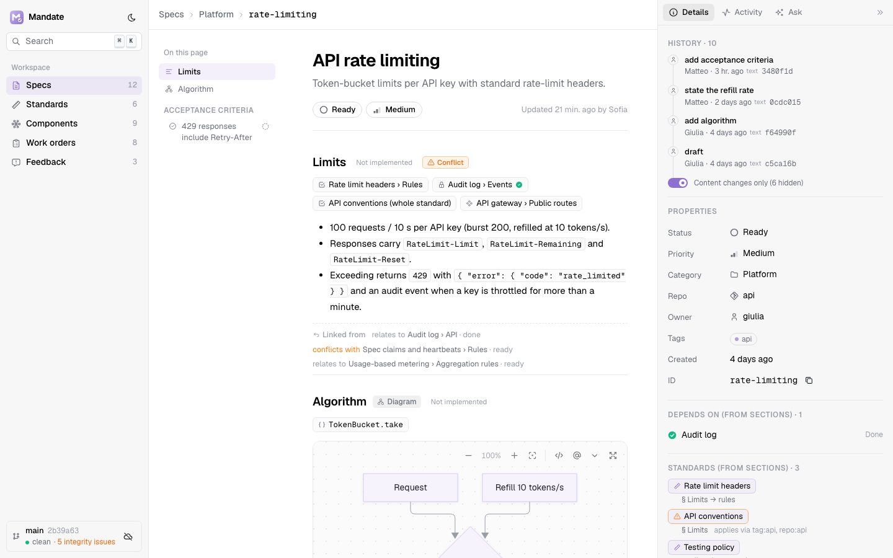
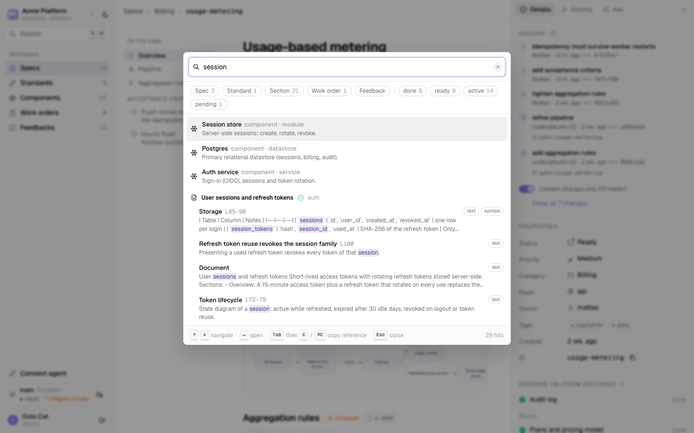
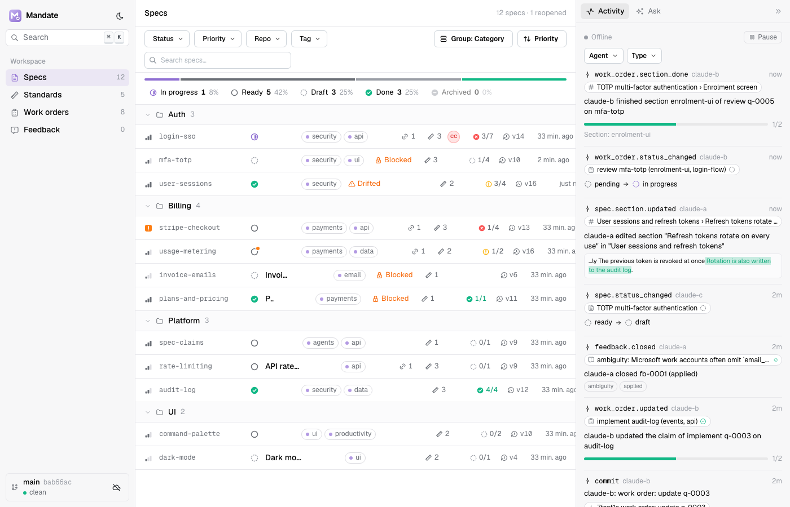
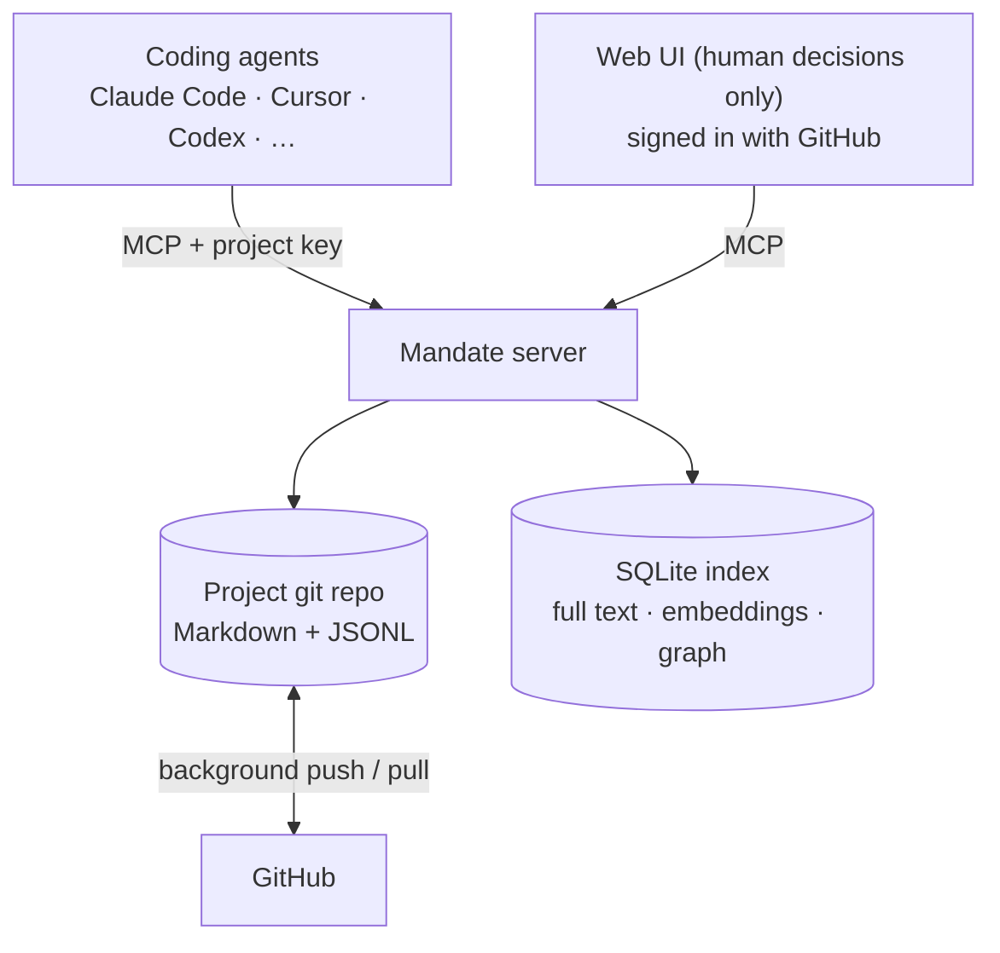

<p align="center">
  
</p>

<h1 align="center">Mandate</h1>

<p align="center">
  <b>The specification system your coding agents actually read.</b><br/>
  Specs, standards and architecture in git, served to any coding agent over MCP, with a calm, read-only UI for humans.
</p>

<p align="center">
  
</p>

---

## Why Mandate

Coding agents are fast, but they forget. They work from whatever context happens to be in the prompt, so the decisions that
matter (what to build, which rules apply, how the system fits together) get lost between sessions, agents and people.

Mandate gives that knowledge a home:

- **Specs say what to build.** They are split into typed sections, with acceptance criteria and links to the code they touch.
- **Standards say how to build it.** They hold rules with *must / should / may* levels, Do/Don't examples and scopes.
- **Components describe the system** and generate a layered architecture diagram.
- **Work orders** hand specific sections to an agent, track the claim and record what got done.
- **Feedback** captures what was unclear, and links to the spec or standard change that resolved it.

Everything is plain Markdown and JSONL in a **git repository**: every change is a commit, every version can be referenced,
and nothing is locked in. Agents read and write through **MCP** (the only interface), so it works with Claude Code, Cursor,
VS Code, Codex, Gemini CLI and any other agent that speaks MCP.

## A quick tour

### Specs and standards

Each document is a list of typed sections: markdown, Mermaid diagrams, HTML mockups, acceptance criteria and rules.
Sections link to other sections, to standards, to components and to exact lines of code (`repo/path#L10-40`, symbols).
The right-hand rail shows history, properties, dependencies and the standards in force, and **Word-style tracked
changes** come straight from git history.

Anything can be copied as a reference, for example `@mandate:mandate://specs/rate-limiting/sections/limits`. Paste it into
your coding agent and it resolves to exactly that section, at the current or a pinned version.

### Work orders


A work order points at the **sections** an agent should implement or review, pinned to a commit. Agents pick one
atomically (`work_order_next`), keep their claim alive with heartbeats, mark sections done and record verifications.
The dependency graph shows what is upstream and what is waiting on it.

### Architecture


Components declare the code they own (globs), their layer, their dependencies and the components they contain. Mandate
draws the layered, top-to-bottom diagram, flags dependencies that point *up* a layer, and lets you pan, zoom, collapse
groups and focus on a component's neighbourhood.

### Search everything



<kbd>⌘K</kbd> searches full text, meaning (embeddings), symbols, code paths and IDs together, with facets by kind and status.
Agents get the same search over MCP, plus a temporal **knowledge graph** they can traverse or query with a
**Cypher** subset: "what breaks if this standard changes?", "which specs touch `src/auth/session.ts`?", "what did this
look like last Tuesday?".

### Live activity and Ask



The **Activity** tab streams what agents are doing as it happens (section edits as inline diffs, status changes, claims,
verifications, commits), and pages refresh on their own. The **Ask** tab answers questions about the project with the
model of your choice. It uses the same read-only MCP tools, shows each tool step (including the Cypher it ran), and
answers with clickable references, tables and graphs.

## How it works



- **Projects.** Each project is its own GitHub repository (or a folder in one), with its own index, activity feed, Ask
  history and MCP endpoint (`/p/<project>/mcp`). New projects are created in the UI by picking a GitHub repo, personal
  or from an organisation.
- **The UI can record human decisions; content stays agent-written.** From the Overview (and the feedback and work
  order pages) a person with write access can accept, reject or dedupe feedback, approve a waiver, release a stale
  claim or snooze an integrity warning. These go through the same MCP write tools as agents (gates, commits,
  activity), attributed to the signed-in user; every other write tool is refused for the UI session. Everything else
  is one click away as "Copy prompt for your coding agent".
- **Git is the database.** Writes are commits with `Agent:` / `Work-Order:` trailers. Mandate pushes in the background
  and never force-pushes.
- **Strict by design.** Every MCP call is validated: status transitions, a done gate on acceptance criteria, claim
  conflicts, link direction rules, append-only verifications and immutable closed feedback. Errors carry codes an agent
  can act on.
- **Indexes stay current.** Full-text, symbol and graph indexes update on every commit. Embeddings are computed in the
  background through a durable SQLite job queue.

## Quick start

Requirements: Node.js 22+ (and git, to push your projects). No compiler needed: native modules ship prebuilt.

### On your machine (default)

```sh
npx getmandate install
```

It asks one question (local or server; local is the default), installs the `mandate` command, starts Mandate in the
background (launchd on macOS, systemd `--user` on Linux) on http://localhost:4000, adds the Mandate skill and the `/mandate-flow`
command to the coding agents it finds, and opens the setup wizard in your browser. Projects are plain git repos in
`~/mandate/`, pushed with your own git credentials. No GitHub account or app is needed.

Then, in each code repository:

```sh
cd ~/code/my-app
mandate connect
```

`connect` links the repo to a Mandate project. It offers to create one in `~/mandate/` or lets you pick an existing
one. It writes the project's MCP server entry for your agents (`.mcp.json`, `.codex/config.toml`, `.cursor/mcp.json`,
…) and a short "Mandate" section in `CLAUDE.md` / `AGENTS.md`.

These files never contain a key, so they are safe to commit. They reference `$MANDATE_KEY_<PROJECT>`, which
`~/.mandate/env.sh` exports (mode 0600) and your shell profile loads.

Then just ask your agent for what you want (*"add remember-me to login"*). The Mandate skill takes it from there; see
[How agents work with Mandate](#how-agents-work-with-mandate).

### On a server (GitHub sign-in)

```sh
npx getmandate install --mode server --public-url https://mandate.example.com
```

Teammates sign in with GitHub, and projects come from GitHub repos. The installer:

- binds behind your reverse proxy;
- prints ready-to-use Caddy (automatic HTTPS) and nginx configs, tuned for MCP's streaming responses;
- installs a systemd unit;
- prints the one-time setup link with the SSH tunnel to reach it safely (`ssh -L 4000:localhost:4000 you@server`).

Developers then run `npx getmandate connect --url https://mandate.example.com --project <id>` in their repos. It asks
for the agent key from the web UI's **Connect agent** dialog and keeps it in `~/.mandate/env.sh` only.

**Who sees what.** Access follows GitHub, per project: if you can read a project's repo, you see the project and your
agents can use the read tools; if you can push, they can also write (org and team grants count, checked with your own
GitHub token and cached for 5 minutes). Without access the project doesn't exist for you (404). `allowedUsers` /
`allowedOrgs` optionally restrict who may sign in; people in `allowedUsers` are the admins (create projects, Settings).

**Agents act as you.** `claude mcp add --transport http mandate-<project> https://mandate.example.com/p/<project>/mcp`
opens GitHub sign-in in your browser (MCP OAuth: Mandate is the authorization server, with PKCE and short-lived,
project-bound tokens). No key to copy. Agents without OAuth support use a personal token from the Connect dialog
(shown once, revocable). Writes are recorded with your GitHub login.

**Database (optional, Settings → Database).** Server state (sign-in sessions, GitHub tokens, personal tokens, OAuth
grants, idempotency results) lives in SQLite (`~/.mandate/state.sqlite`) by default. To share it between several server
instances, switch to Postgres: put the URL in `~/.mandate/secrets.env` (never in `config.json`) and select it:

```json
"database": { "driver": "postgres", "urlEnv": "MANDATE_DATABASE_URL", "ssl": "require", "pool": { "max": 10 } }
```

Mandate creates the `mandate_server` schema and one `mandate_<project>` schema per project: the search index (weighted
full text, trigram, pgvector HNSW, the temporal graph) is published there after every sync and `graph_query` runs on it.
It needs PostgreSQL 14+ with `vector` (pgvector) and `pg_trgm`. Moving an existing server: `npm run mandate -- db copy`
copies sessions and tokens from SQLite (the index is rebuilt from git). **Test connection** in Settings checks all of that. Your specs stay in git;
several instances need the data repos on shared storage (writes take a per-project Postgres advisory lock) or one writer
per project. Details: `plans/postgres-notes.md`.

**Supabase.** Use the **direct connection** (`db.<ref>.supabase.co:5432`) or the **session pooler** (port 5432 on
`*.pooler.supabase.com`), not the transaction pooler (6543); add `?sslmode=require`. Enable `vector` and `pg_trgm` under
Database → Extensions (Supabase installs them in the `extensions` schema; Mandate detects that and schema-qualifies them),
or press **Enable missing extensions** in Settings. With a transaction pooler Mandate still works (prepared statements
off, transaction-scoped locks, no session state), but the direct or session connection is recommended.

### Commands

| | |
|---|---|
| `mandate open` | Open Mandate: the setup wizard, or a one-time sign-in link (local mode) |
| `mandate connect [--project id] [--remove]` | Link the current repo to a project for your coding agents |
| `mandate status` · `doctor` | State, URL, version, projects and setup; diagnostics with fixes |
| `mandate start` · `stop` · `restart` · `logs -f` | Control the background service (`start --foreground` runs it in the terminal) |
| `mandate update` | Install the latest version and restart |
| `mandate uninstall [--purge]` | Remove the service and all agent wiring; keeps `~/.mandate` unless `--purge` |
| `mandate key create <project>` · `key list` · `key revoke <id>` | Agent keys |
| `mandate agents` | Coding agents found on this machine: what each supports, and what is installed |
| `mandate bootstrap init · status · validate · clean` | Run folders for `/mandate-bootstrap` (kept under `~/.mandate`, never in a repo) |

`install`, `connect` and `uninstall` are idempotent and take `--dry-run` (show the changes) and `--yes` (accept the
defaults).
- They act on the detected agents by default; use `--agents claude,codex,…` to choose, or `--all` for every agent.
- Every file they write is marked as managed by Mandate and removed again by `uninstall`.
- Agent configs never hold a key in a repository. Agents that can read env vars reference `MANDATE_KEY_<PROJECT>`.
  Agents that can't keep the key in their own user config, with mode 0600.

### Supported agents

All paths and formats come from each agent's official docs (checked 2026-11-12). Capabilities that couldn't be
verified are written only with `--force`.

| Agent | MCP | Skills | Commands | Instructions file |
|---|---|---|---|---|
| Claude Code | ✓ (`${VAR}`) | ✓ `~/.claude/skills` | ✓ `.claude/commands` | `CLAUDE.md` |
| Codex | ✓ (`bearer_token_env_var`) | ✓ `~/.agents/skills` | ✓ `~/.codex/prompts` | `AGENTS.md` |
| Cursor | ✓ (`${env:VAR}`) | ✓ `~/.agents/skills` | ✓ `.cursor/commands` | `AGENTS.md` |
| VS Code (Copilot) | ✓ (`${env:VAR}`) | ✓ `~/.agents/skills`, `~/.copilot/skills` | ✓ `.github/prompts` (repo) | `AGENTS.md` |
| Gemini CLI | ✓ (`${VAR}`) | ✓ `~/.agents/skills` | ✓ `.gemini/commands` (TOML) | `GEMINI.md` |
| Windsurf / Devin Desktop | ✓ (`${env:VAR}`) | ✓ `~/.agents/skills` | – (MCP prompts) | `AGENTS.md` |
| opencode | ✓ (`{env:VAR}`) | ✓ `~/.agents/skills` | ✓ `.opencode/commands` | `AGENTS.md` |
| JetBrains Junie | ✓ user scope (literal key) | ✓ `~/.agents/skills` | unverified | `AGENTS.md` |
| Amp | ✓ (`${VAR}`) | ✓ `~/.agents/skills` | – (skills) | `AGENTS.md` |
| Goose | manual (YAML snippet printed) | ✓ `~/.agents/skills` | – | `AGENTS.md` |
| Cline | ✓ user scope (literal key) | ✓ `~/.cline/skills` | – (MCP prompts) | `AGENTS.md` |
| Zed | unverified | ✓ `~/.agents/skills` | – | `AGENTS.md` |

- Skills are written once per shared folder (`~/.agents/skills` serves most agents).
- Agents without slash commands get the same two commands as the MCP prompts `mandate-flow` and `mandate-bootstrap`.

## How agents work with Mandate

One master skill (`~/.claude/skills/mandate`, `~/.agents/skills/mandate`) defines the flow. The MCP server's
instructions carry the same rules, so agents without the skill follow it too.

- **Start.** `project_info` gives the agent its effective setting: whether the flow is on and whether to stop for
  approval. If the flow is off, Mandate is used for read context only.
- **Intake** (you ask for a feature or change):
  1. The request is recorded as feedback.
  2. `spec_match` finds where it fits: already covered, extend a section, new section, new spec, or a cross-cutting
     rule that belongs in a standard.
  3. The agent shows you the plan (refs, spec diff, components, work order) and waits for your go.
  4. It updates the spec (every changed section gets acceptance criteria) and the components.
  5. It opens a work order and closes the feedback as applied.
  - A bug fix with no behaviour change skips the spec edit but still gets a small work order.
- **Delivery** (a work order is picked up):
  1. The agent claims it and keeps it alive with heartbeats.
  2. It marks sections done as they land and records a verification for each acceptance criterion.
  3. It reconciles the spec and components with what was built (deviations, code refs, owns globs).
  4. It completes the work order through the done gate.
  - If the spec is unclear, the agent files feedback and asks instead of guessing.
- **Standards** are never changed without your explicit confirmation. This holds even with approval off.
- **Flow settings** come in two layers:
  - **Project policy**, set by an admin in Settings → Agent flow:
    - flow: *required*, *optional* (the default) or *off*;
    - approval: *required* or *optional*.
  - **Per agent client**, when the policy is optional:
    - `/mandate-flow on|off|status` (and `approval on|off`) in the agent changes only that client, e.g. your Claude Code;
    - the client is identified by your GitHub user plus the client name on a server, or the client plus its key locally;
    - the preference is stored in the server database, and other clients and users are unaffected.
  - The sidebar badge shows your effective state. Its hover card lists your agents.
  - Settings → Agent flow does the same in the UI.
- **`/mandate-bootstrap`** reverse-engineers an existing codebase into Mandate. It is its own skill and runs in three
  stages, each by a fresh agent:
  1. **extract:** typed notes, kept in `~/.mandate/bootstrap/`;
  2. **distill:** components, standards and specs, with checkpoints and your confirmation for every standard;
  3. **review:** cross-checks the result against the code.
  - Everything it writes is marked *Inferred* until you confirm it.
  - `/mandate-bootstrap --resume` continues a run.

## Configuration

Everything lives in `~/.mandate/`. Secrets are only ever referenced by environment-variable name.

| File | What it holds |
|---|---|
| `config.json` | Your settings: mode, GitHub sign-in, Ask models, embeddings, git backend, auto-push defaults. Edited by the setup wizard / Settings (atomic, refuses to overwrite outside edits) or by hand |
| `secrets.env` | API keys and the GitHub client secret (`KEY=value`, mode 0600, never logged) |
| `projects.json` | The project registry, managed by Mandate |
| `keys.json` | Per-project agent keys (mode 0600) |
| `state.sqlite` | Server state: sessions, encrypted GitHub tokens, personal / OAuth tokens, idempotency (SQLite default; or Postgres via `database`) |
| `env.sh` | `export MANDATE_KEY_<PROJECT>=…` for agent configs, written by `mandate install` / `connect` (mode 0600) |
| `logs/server.log` | The background service's log (`mandate logs -f`) |

**Ask models.** Configure as many as you like and pick one per question in the Ask box. Anthropic, OpenAI, Google and any
OpenAI-compatible endpoint (including a local Ollama) are supported:

```json
"ask": {
  "default": "opus",
  "models": [
    { "id": "opus", "label": "Opus 5.5", "provider": "anthropic", "model": "claude-opus-5-5", "apiKeyEnv": "ANTHROPIC_API_KEY" },
    { "id": "local", "label": "Llama (local)", "provider": "openai-compatible", "model": "llama3.1", "baseUrl": "http://localhost:11434/v1" }
  ]
}
```

Ask keeps answers lean. Limits are optional under `ask` (and per model):
- `maxToolCalls`: 12.
- `tokenBudget`: 150,000 tokens per question. It is checked before each step, and near it the model must answer.
- `maxToolResultTokens`: 5,000. This is a hard cap on each tool result the model reads; override it per tool with `toolResultTokens`. The `*_section_get` tools default to 8,000.
- Results reach the model compacted, and a capped result points to narrower calls first.
- Only the common tools are loaded on every step; the model loads the others with `find_tools`.
- `ask_status` shows the caps.

## Development

```sh
git clone https://github.com/snork-alt/mandate.git
cd mandate
npm install
npm run dev          # API on :4000, web UI with hot reload on :5173 (Vite proxies /p/*/mcp, /mcp, /auth, /ui)
npm run seed         # optional: a sample project with specs, standards, components and work orders
npm run mandate -- key list
```

```sh
npm run typecheck
npm test             # vitest across packages
npm run build        # server + web dist + the publishable CLI (packages/cli/dist)
npm start            # production mode: one port, the server serves the built UI
npm run smoke        # npm pack → npx <tarball> install in a temp HOME → start → /health → UI (port 4300)
```

| Package | |
|---|---|
| `packages/doc` | The document format: sectioned Markdown with frontmatter, pluggable section types, byte-stable round trips |
| `packages/shared` | Types, zod schemas and `mandate://` references shared by server and UI |
| `packages/server` | Fastify + MCP server, git storage (embedded libgit2 or the git CLI), SQLite index, Cypher compiler, Ask agent |
| `packages/web` | React + Mantine UI, itself an MCP client |
| `packages/cli` | The `getmandate` npm package: the `mandate` command, service, agent wiring; bundles the server and the built UI |
